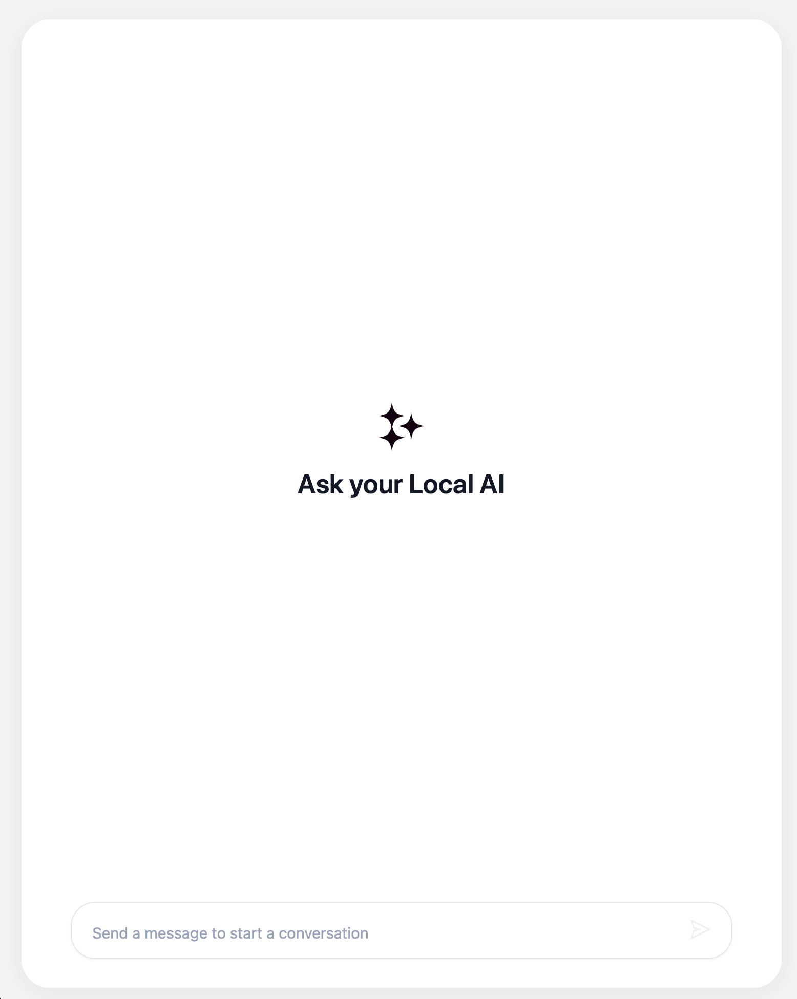
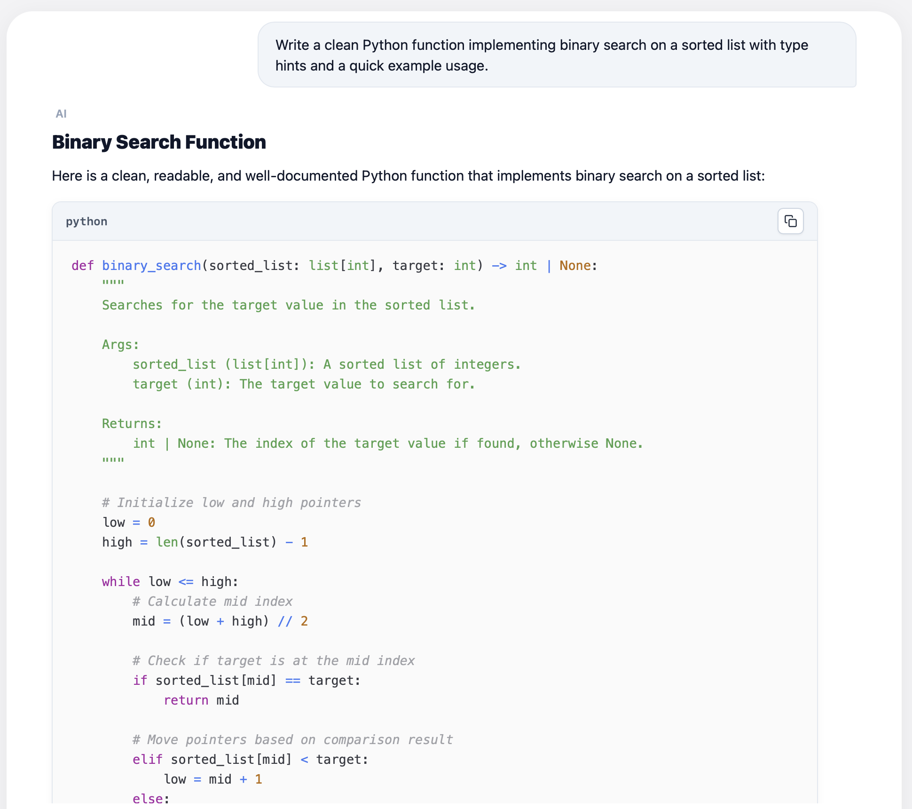
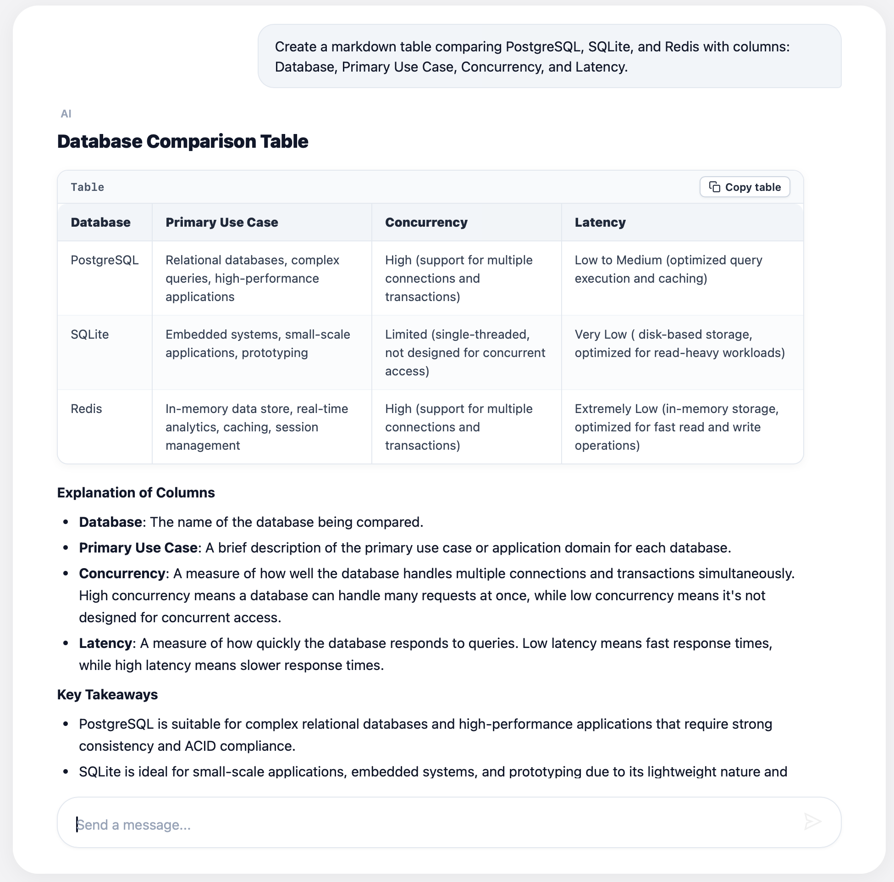

# Local LLM Chatbot

A minimal full-stack chat application featuring a custom frontend with light interface, native markdown rendering, code syntax highlighting, and copy controls, a Python backend API, and a locally hosted LLM via Ollama.

<p align="center">
  
</p>

## Overview

The system consists of three decoupled layers:
- Local LLM service managed through Ollama running `llama3.1:8b`.
- Asynchronous REST API developed with FastAPI to orchestrate communication between the client and local inference runtime.
- Client single-page application built on React, TypeScript, and Vite featuring auto-expanding input, table rendering via GitHub Flavored Markdown, and Atom One Light code presentation.

## UI Features & Screenshots

### Code Presentation & One-Click Copy
Syntax-highlighted code blocks styled in One Light theme with language detection and a compact status-reactive copy trigger.

<p align="center">
  
</p>

### Formatted Data Tables
Clean table views with border separation, header indicators, horizontal overflow scrolling, and a dedicated table markdown copy button.

<p align="center">
  
</p>

## Prerequisites

- Ollama with downloaded `llama3.1:8b` weights
- Python 3.10+ with `venv`
- Node.js 18+ and npm

## Setup & Running

Execute services across three terminal instances.

### 1. Model Runtime
Ensure Ollama is running and serve the base model:

```bash
ollama run llama3.1:8b
```

### 2. Backend API
Set up Python virtual environment, install requirements, and run the Uvicorn server:

```bash
cd backend
python3 -m venv .venv
source .venv/bin/activate
pip install -r requirements.txt
uvicorn main:app --reload --port 8000
```

### 3. Frontend Application
Install client dependencies and launch the Vite development server:

```bash
cd frontend
npm install
npm run dev
```

## Repository Structure

```text
local_llm_chatbot/
├── backend/
│   ├── config.py
│   ├── database.py
│   ├── main.py
│   ├── requirements.txt
│   └── schemas.py
├── frontend/
│   ├── public/
│   │   ├── app-icon.svg
│   │   └── send-icon.svg
│   ├── src/
│   │   ├── components/
│   │   │   ├── ChatInput.tsx
│   │   │   ├── ChatMessage.tsx
│   │   │   ├── CopyButton.tsx
│   │   │   └── WelcomeScreen.tsx
│   │   ├── api.ts
│   │   ├── App.css
│   │   ├── App.tsx
│   │   ├── main.tsx
│   │   └── types.ts
│   ├── package.json
│   ├── tsconfig.json
│   └── vite.config.ts
├── docs/
│   ├── app-preview.png
│   ├── code-preview.png
│   └── table-preview.png
├── .gitignore
└── README.md
```
